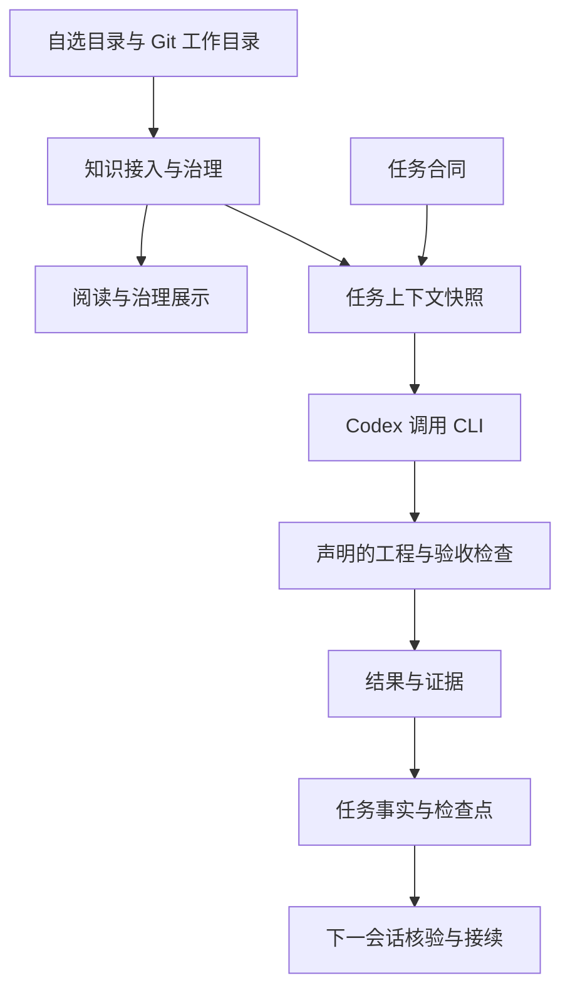

# ai2workspace 知识治理与 Harness 设计

> 当前职责、目录和模块依赖以 [职责与文档归属](03-职责与文档归属.md) 为准。本页保留原方案和验证历史；其中旧路径不作为新的组织约定。

依据：[通用工作区需求](../product/requirements/02-通用工作区需求.md)的 DEC-AW-001—012、FR-AW-001—010。日期：2026-11-15。产品方向已经讨论确认；以下为第一版工程合同。后续用户已授权完整方案实施、知识库重构和重命名，当前处于迁移与验证阶段。CLI 已登记任务以 TaskState 为准，未登记迁移与人工验收缺口见根 BACKLOG.md。

## 1. 摘要

ai2workspace 是本机单用户、可管理多个项目空间的通用知识治理服务。用户在 Codex 发起任务；服务提供知识治理、上下文、检查与交接，CLI 执行显式配置的检查，网页负责阅读、配置与治理结果展示。

共享空间描述、本机绑定、原始资料和运行数据各有所有者。基础知识能力不要求研发模板；研发配置增加来源追踪、任务合同、工程检查及恢复。服务自身使用相同机制，先证明一次真实任务可以跨 Codex 会话接续。

本设计不创建 Agent 推理循环，不调度 Codex，不提供网页执行入口；检查子进程不等于编码任务运行器。

## 2. 参与者

| 参与者          | 职责与边界                                                                      |
| --------------- | ------------------------------------------------------------------------------- |
| 本机使用者      | 选择知识源、工程、适用规则和任务目标，决定确认结论与例外                        |
| Codex           | 在当前授权范围实施修改，调用 CLI 获取上下文、检查和交接；现有指令优先级继续适用 |
| Core            | 校验配置、登记身份、组装快照、计算检查有效性、维护任务与交接事实                |
| CLI             | 使用同一 Core 执行声明检查，采集真实进程结果；不从正文推断可执行命令            |
| Web             | 展示最新知识、治理问题、任务与证据，维护空间配置；无任务执行接口                |
| 后续 Codex 会话 | 读取交接并核对现场后接续，不凭旧摘要跳过校验                                    |

首版角色是职责标签，不是多用户权限系统，也不自动产生多个 Agent；配置角色不授予额外工具或操作权限。

## 3. 背景

### 3.1 方案编写时的实现事实（迁移前历史）

最初编写此方案时，运行产品仍名为 Ai2sd，应用在 `workspace/`。`workspace/lib/source.ts` 固定扫描 `content/`，通过 `document-ids.json` 维护稳定 URL；根规范没有自动纳入发布正文或 LLM 全文。阅读页生成静态参数，Markdown/LLM 路由存在静态枚举与缓存假设。现有 lint、类型、构建及浏览器测试只证明文档站自身，不证明绑定工程的检查或交接能力。

本地 Fumadocs Core 16.19.3 包含动态内容源接口，官方搜索接受异步来源；这是接口存在性的观察，不等于外部目录、缓存、搜索与部署组合已经验证。保留官方 UI、主题、Markdown 和搜索能力，动态加载适配必须经过实际验证。

### 3.2 方案比较

| 方案                                  | 取舍                                           | 决定           |
| ------------------------------------- | ---------------------------------------------- | -------------- |
| 每项目复制文档站及规范                | 初期简单，升级与治理容易分叉，知识绑定应用目录 | 不作为通用方案 |
| 一开始拆分多个独立服务                | 运行与一致性成本高，当前没有规模依据           | 不用于首版     |
| 通用 Core、独立空间、Web/CLI 共享合同 | 保留知识所有权，能够渐进验证闭环               | 已接受方向     |

### 3.3 参考边界

三张截图支持职责划分和协作思路，不复制其中业务架构。方法参考 [OpenAI Harness engineering](https://openai.com/index/harness-engineering/)、[Anthropic 长任务交接](https://www.anthropic.com/research/effective-harnesses-for-long-running-agents)和 [Agent 评估](https://www.anthropic.com/research/demystifying-evals-for-ai-agents)：采用简短规则入口、版本化知识和真实结果验证。以下接口是自身工程方案，不宣称文章提供了相同实现或完成保证。

## 4. 目标

- 保留资料位置与编辑方式；配置可独立于只读知识目录。
- 多空间身份、查询、缓存和运行记录隔离。
- Codex 获得适用规则、任务依据、工程初始状态和可恢复上下文。
- 由检查和交付条件推动状态，过期、失败和缺失事实不能包装成通过。
- 换会话可恢复现场，保留已有用户修改，不自动提交或清理。
- 先用服务自身真实任务证明价值，再扩展治理与呈现。

非目标：网页编码执行、Agent 调度、团队账号、跨机同步、远程 Git 自动拉取、Notion/云盘、收费模型调用、向量数据库、自研渲染器、自动发布或生产数据操作。不承诺拦截所有绕过 CLI 的外部修改。

## 5. 使用场景

| 场景       | 行为与结果                         | 追踪                       |
| ---------- | ---------------------------------- | -------------------------- |
| 接入资料   | 扫描原样目录，问题单独展示         | ST-AW-001 / AC-AW-001、003 |
| 准备任务   | 根规范、显式资料与依赖形成快照     | ST-AW-002 / AC-AW-004      |
| 实施后检查 | Codex 调 CLI，证据绑定候选输入     | ST-AW-003 / AC-AW-006、007 |
| 依据变化   | 相关依据复核，候选改变使旧检查过期 | ST-AW-004 / AC-AW-005      |
| 中断交接   | 新会话先比较现场再恢复             | ST-AW-005 / AC-AW-008、009 |
| 多空间     | 同名文档、ID、任务不混用           | ST-AW-006 / AC-AW-002      |

## 6. 价值

减少跨项目、跨会话的重复解释；保留“依据什么实施、检查了什么、还缺什么”的项目资产。用来源、版本和证据定位偏差，不以文档数量、Agent 数量或一次命令成功衡量交付。

治理存在配置与维护成本，首个闭环只引入完成真实接续所需的配置、身份、快照、检查与交接，不为目录完整度预建独立服务。

## 7. 方案

### 7.1 模块与依赖



Web 和 CLI 调用共享 Core；Core 不依赖 Next.js、React 或 CLI 输出格式。Core 内按 spaces、knowledge、context、checks、tasks、storage 分职责，不拆独立部署服务。CLI 在 Web 未运行时也能完成最小闭环。

### 7.2 配置与存储合同

`workspaceDir` 是使用者选择的可写空间配置目录；`dataDir` 是本机私有运行根目录；binding 是本机路径引用。它们不要求位于服务仓库或知识目录内部。

| 对象                 | 权威位置                                            | 所有权与恢复                             |
| -------------------- | --------------------------------------------------- | ---------------------------------------- |
| 空间、检查、治理定义 | `workspaceDir/workspace.yaml`                       | 可入 Git，不保存个人绝对路径             |
| 本机映射             | `workspaceDir/workspace.local.yaml`                 | 私有，不入 Git；路径、工具和环境引用     |
| 身份与侧载元数据     | `workspaceDir/catalog.json`                         | 持久资产，可按访问范围共享，不当缓存删除 |
| 任务合同             | `workspaceDir/tasks/<id>/contracts/<revision>.json` | 不可覆盖的修订；是否入 Git 由项目决定    |
| 当前任务、运行、交接 | `dataDir/spaces/<spaceId>/`                         | 本机事实，不随共享配置自动同步           |
| 原文与附件           | 各绑定目录                                          | 原所有者维护，不形成第二份权威正文       |
| 索引与缓存           | 运行目录 `indexes/`                                 | 可重建，不承担身份或历史唯一保存职责     |

本机首次指定 workspaceDir；dataDir 默认 `workspaceDir/.local/ai2workspace`，可移到其他私有目录。本机配置和运行数据须排除 Git。当前实施已创建 `spaces/self/workspace.yaml` 及本机私有绑定；示例字段以 Core 合同为准，不能把下方示意视为已通过的运行结果。

共享配置示例：

```yaml
schemaVersion: 1
id: ai2workspace-dev
name: ai2workspace 研发空间
profile: development
sources:
  - id: knowledge
    binding: knowledge-root
    kind: knowledge
    include: ['**/*.md']
    exclude: ['.git/**', 'node_modules/**', '.local/**']
    writePolicy: task-scoped
  - id: engineering-rules
    binding: service-root
    kind: instruction
    projectId: service
    include: ['AGENTS.md', 'PROJECT.md', 'DESIGN.md']
    writePolicy: task-scoped
projects:
  - id: service
    binding: service-root
    inputExclude:
      [
        'node_modules/**',
        '.git/**',
        '.next/**',
        '.source/**',
        'test-results/**',
        'playwright-report/**',
        '.local/**',
      ]
checks:
  - id: service-types
    projectId: service
    cwd: .
    argv: [pnpm, types:check]
    timeoutMs: 120000
    required: true
    tools:
      - id: node
        argv: [node, --version]
      - id: pnpm
        argv: [pnpm, --version]
    environment:
      publicNames: [NODE_ENV, CI]
      privateRefs: []
    artifacts: []
```

| 字段            | 规则                                                                                       |
| --------------- | ------------------------------------------------------------------------------------------ |
| schemaVersion   | 首版固定 1，未知版本拒绝加载                                                               |
| 逻辑 ID         | 空间/来源/工程/检查 ID 为小写字母、数字与连字符，1—64 字符，不从名称派生；各自在空间内唯一 |
| profile         | generic 或 development；研发规则不自动施加到普通资料                                       |
| sources         | 至少一项，kind 为 knowledge、reference、instruction                                        |
| binding         | 在本机 bindings 映射中唯一解析；缺失为 blocked                                             |
| include/exclude | 相对根的 glob，拒绝绝对路径和上跳；隐藏目录默认不扫描，显式规则文件除外                    |
| writePolicy     | read-only 或 task-scoped；后者不构成新授权，服务不自动改正文                               |
| projects/checks | 普通知识空间可为空；检查必须命名工程，不能默认在服务目录执行                               |

本机绑定示例：

```yaml
schemaVersion: 1
bindings:
  knowledge-root: /absolute/path/to/knowledge
  service-root: /absolute/path/to/checkout
autoScan: false
```

首个闭环采用启动或显式扫描，不实现文件监听。共享配置和快照不保存秘密值；检查只引用现有环境变量名，不把凭据读出、打印或复制入上下文。

### 7.3 接入、身份与治理

首期支持普通 `.md` 和允许的本地附件。文件系统源可位于 Git 工作目录，但扫描不执行 fetch、pull、checkout 或 reset。Git 版本是补充，真实文件仍以当前工作目录为准，普通目录不要求初始化 Git。

验证真实路径位于绑定根内；首期不遍历符号链接。默认排除 `.env`、私钥、运行目录、依赖和构建产物。外部资料按普通 Markdown 处理，不执行 MDX 的 JavaScript、JSX 或原始 HTML，也不自动请求远端图片。当前受控内容编译配置不能直接用作外部资料信任模型。

文档键为 `(workspaceId, sourceId, documentId)`。已有稳定 ID可登记沿用；缺失则在登记表分配 UUID，路径只是定位。重扫复用身份；移动通过显式映射或无歧义 Git 重命名辅助，不能确定时报告待关联，不静默合并。相同正文可以是不同文档。

元数据包括类型、领域、适用工程、来源、依赖和治理状态。侧载登记为首期权威；正文已有字段可读取，冲突必须报告。状态为 unclassified、draft、confirmed、superseded，缺失为 unclassified；导入器或 Codex 不凭语义推断用户确认。确认记录绑定正文摘要和 decisionRef；正文变化后旧确认仍保留，但不能自动确认新正文。

登记由扫描创建；补注通过 `catalog annotate --input <file> --reason <text>` 提交有 schemaVersion、文档键、预期 catalogRevision、字段变更与 decisionRef 的 JSON。confirmed/superseded 必须附明确决定依据，命令记录本机操作者和理由；不将该记录描述为宿主聊天身份的密码学验证。首个自用配置可显式登记已接受的根工程规范，不能靠扫描器推断。

基础检查验证可读性、身份、链接和附件；资料检查报告来源、适用范围和冲突；任务就绪只对任务声明的必需依据实施门禁。远端链接首期仅登记，不声称固定其内容或验证其可用性。

每次扫描形成 sourceRevision，包含文件清单和内容摘要；Git 源附带 HEAD 与工作目录变化摘要。所有登记、链接和查询按空间/来源隔离，不提供跨空间的全局同名文档解析。

### 7.4 阅读与索引一致性

Web 读取最新完成的扫描修订，目录、正文、Markdown 和搜索必须属于相同修订。新索引完成前提供旧修订并标记更新中；失联时标记最后成功修订、时间与过期状态，不能据旧缓存认定当前任务就绪。

首个闭环先保证 Core/CLI 来源修订一致，不要求立即完成多空间网页。后续同时调整阅读、目录、搜索、Markdown/LLM 和缓存，不能只替换 loader。旧 `/read/<id>` 身份在实际迁移时保留映射，迁移保持旧 ID。

### 7.5 任务合同与上下文快照

TaskContract 字段：schemaVersion、id、workspaceId、revision、kind、goal、scope、projectIds、inputs、acceptance、checkIds、delivery。kind 为 implementation 或 knowledge-maintenance；inputs 包含文档键、可选章节、用途、必需性。验收项有稳定 ID，映射自动检查、人工判定或交付产物。小任务可直接声明目标与验收，不机械创建完整 PRD 链。

delivery 声明产物和是否需要明确人工验收；不默认增加人工点击或授予 Git/发布权限。合同修订不可覆盖，变更保存理由与上一修订。TaskState 引用合同和快照，合同不反向包含 snapshotId，避免哈希循环。

准备顺序：

1. 验证空间、绑定、工程现场与已有用户修改。
2. 加载明确配置的适用指令、任务显式资料和必需依赖。有效依据来自用户或已授权任务指定，不从检索候选自动提权。
3. 解析依赖闭包；必需引用缺失、依赖环、规则冲突或不满足所需确认状态时拒绝就绪；可选缺失记录缺口。
4. 保存选中资料和允许附件的实际副本，不复制整库；首期保存所选整篇正文并标出引用章节，不用自动摘要替代原文。
5. 扫描前后复核内容摘要；准备期间仍变化则退出 stale，不产生混合时点快照。
6. 原子封存 manifest、对象及摘要后转为 ready。

manifest 包含 schemaVersion、workspaceId、contractHash、profileHash、sourceRevisions、documents、attachments、projectBaselines、missingOptional。正文项保存文档键、原路径、用途、确认状态、摘要和选中章节。导出分开列出规则、确认依据、候选资料与缺口。

snapshotId 为 `snap_` 加规范化 manifest 的完整 SHA-256；时间、ID和机器绝对路径保存在 envelope，不进入摘要。清单只含相对对象路径。快照不可覆盖，同样输入可复用 ID，但来源当前可用性仍需复核。

工程基线包含项目、绑定修订、可选 Git HEAD、受范围约束的 tracked/untracked 输入清单及摘要、初始差异引用。非 Git 工程使用清单，不编造提交号。生成物明确排除，实际业务输入不能通过忽略规则漏出。

首次 prepare 在任何本任务修改前封存 `tasks/<id>/origin.json` 指向的 TaskOrigin，含初始 HEAD、允许输入文件清单和实际差异副本，write-once 保存。差异也受来源/工程排除规则约束，不采集完整仓库的无关私有文件。它表示“首次准备时已存在的差异”，不臆测改动作者。后续 rebaseline 另存当前候选，始终引用原 TaskOrigin，不能把本任务已做的修改重新记为初始用户差异。若任务开始修改后才首次准备，必须标明 late_prepare 限制，不能伪造更早现场。保存这些内容用于比较，不自动应用补丁或重置现场。

初次或完全匹配的 prepare 可以生成/复用快照；已有快照发生漂移时普通 prepare 返回 stale。只有显式 `task prepare --task <id> --rebaseline --reason <text>` 才建立新快照，记录旧/新引用及影响；其授权仍来自当前任务，不自动确认新的需求。

### 7.6 变化与证据有效性

| 变化                           | 处理                                                                                                                                                                                                                               |
| ------------------------------ | ---------------------------------------------------------------------------------------------------------------------------------------------------------------------------------------------------------------------------------- |
| 所选规范、正文、附件或依赖变化 | 标记基线需复核；按内容变化保守处理，不靠模型判断“只是措辞”自动放行                                                                                                                                                                 |
| 无关且非全局规则的资料变化     | 更新索引，不废弃任务与有效检查                                                                                                                                                                                                     |
| 全局适用规则变化               | 引用该规则的活动任务复核                                                                                                                                                                                                           |
| 本任务正常修改目标代码         | 原任务快照保留；新候选指纹使旧工程检查过期                                                                                                                                                                                         |
| 本任务需修改作为依据的文档     | scope.outputs 事先逐一声明文档键/精确路径。当前任务将这些变化记录为产出差异，继续按旧快照验收，不因自身产出无限 stale；其他引用该文档的任务仍复核。若要把新正文作为当前任务的新依据，必须修订合同或显式 rebaseline，并保留确认来源 |
| 合同、检查、绑定或治理配置变化 | 新修订和重新匹配，不覆盖旧结果                                                                                                                                                                                                     |
| 完成任务之后资料变化           | 保留当时完成事实，另标当前适用性，不改历史                                                                                                                                                                                         |

证据只有在快照、合同修订、检查定义、候选输入、相关工具版本与声明环境匹配时支持当前结果。检查定义增加 tools（命名工具和只读版本探测 argv）及 environment（publicNames、privateRefs）；RunRecord 保存工具版本结果、公开环境的缺失/值摘要和环境证明范围。版本探测默认 5000ms，失败则 blocked，不假装已知版本。

每次 verify/resume 重新探测声明工具和公开环境，匹配当前与运行记录；不能仅比较检查配置文件。首个闭环只允许没有声明私有环境依赖的必需检查；遇到 privateRefs 返回 blocked/unsupported_environment，不采集秘密值或秘密哈希。未声明的继承环境不在可复现保证范围。完整第一版可扩展私有环境引用和本机 environmentRevision，但只记录存在性不能证明秘密值没变，须禁用跨会话复用并显式标记证明限制；不得直接沿用公开环境的等值比较承诺。

来源全库摘要变化本身不废弃所有任务，实际比较选中资料和适用规则。scope.outputs 仅对该任务、该合同修订生效，不能临时扩大范围来绕过漂移；它也不豁免候选代码/文档的检查指纹。

### 7.7 CLI 检查与结果合同

以下是共享 CLI 合同，当前已进入实现和最终验证阶段；可用入口以根 PROJECT.md 和实际检查为准。合同入口统一为 `ai2workspace --workspace <workspaceDir> <command> --json`，显式指定空间，不按 cwd 猜测。

| 命令                                                        | 结果与边界                                                         |
| ----------------------------------------------------------- | ------------------------------------------------------------------ |
| `space validate`                                            | 配置错误、缺失绑定与就绪信息；不运行工程命令                       |
| `source scan`                                               | 来源修订、文档身份及治理问题；不改原文或拉取远端                   |
| `catalog annotate --input <file> --reason <text>`           | 校验侧载注记、确认依据和预期 revision；不修改正文                  |
| `task create --contract <file>`                             | 导入合同、建立初始修订与 draft                                     |
| `task revise --task <id> --contract <file> --reason <text>` | 保存下一合同修订与变更依据；状态回到需准备，不改写旧修订或初始现场 |
| `task prepare --task <id>`                                  | 封存快照、就绪判断与缺口；不运行 Agent                             |
| `task prepare --task <id> --rebaseline --reason <text>`     | 显式重建依据，保留 TaskOrigin 和旧快照；不自动确认新内容           |
| `context export --task <id>`                                | 索引与实际正文；不假设已注入宿主上下文                             |
| `check run --task <id> --check <id>`                        | 只运行合同声明的检查，不能临时覆盖 argv/cwd/required               |
| `task verify --task <id>`                                   | 证据有效性和验收覆盖；不编造人工验收                               |
| `task handoff --task <id> --notes <file>`                   | 校验交接说明并生成检查点与摘要；不提交或修复现场                   |
| `task resume --task <id>`                                   | 现场差异、恢复建议与可复用证据；不自动重跑外部动作                 |
| `task complete --task <id>`                                 | 检查交付和验收要求；不等于合并、上线                               |

stdout envelope 为 `{schemaVersion, ok, operation, workspaceId, taskId?, data, issues}`；诊断写 stderr，工程输出写私有 run 目录，不混入 JSON。退出码：0 操作成功，1 检查/验证失败，2 用法/格式错误，3 前置阻塞，4 依据/证据过期，5 revision/锁冲突。查询或交接成功不代表任务通过，必须读取 data 的状态。

工程检查采用独立子进程 argv，首期 shell=false，不接受 shell 字符串或正文命令。cwd 是 binding 内相对目录并经真实路径核验。超时默认 120000ms，允许 1—3600000ms；超时/取消须终止并等待所拥有的进程组。崩溃或无法确认退出不能生成 passed。

检查保存 before/after 输入指纹；输入变化时即使退出码 0 也标 failed/input_changed。明确排除的构建产物不参与候选指纹，但证据产物单独哈希。

首个闭环的必需产物只接受本次新建、初始为空的私有 `runs/<runId>/artifacts/`，由 CLI 通过 AI2WORKSPACE_RUN_DIR 告知检查程序运行根目录；检查适配或项目脚本据此生成报告。拒绝越界和符号链接。旧工程报告即使存在且摘要相同，也不能满足本次必需产物；不自动清空用户已有报告目录。不能输出到本次运行目录的报告首期只能作为诊断附件，不计必需检查证据。

CLI 直接采集的 stdout/stderr 本身绑定当前进程和 runId，不依赖项目预存日志。退出码 0只满足进程检查的一部分，必需产物缺失仍失败；功能行为由对应测试或验收覆盖。

RunRecord 包含 runId、空间/任务/合同/快照、checkId/定义摘要、项目/绑定、候选前后指纹、实际 argv/cwd、tools/environment 证明、开始结束时间、退出码/信号/超时、结果、输出/产物摘要和证据来源。

| 结果    | 语义                                     |
| ------- | ---------------------------------------- |
| passed  | 实际执行、判定和所需证据满足、输入一致   |
| failed  | 未满足判定，包括超时、输入改变、产物缺失 |
| blocked | 前置、工具或环境不足                     |
| skipped | 未执行并保留原因，不当通过               |
| waived  | 存在明确例外，原结果不改成 passed        |

证据来源为 cli-captured、imported-report、human-statement。首个闭环仅实现 cli-captured，不能用自报文本补自动检查。原始输出私有保存，按已知秘密模式脱敏但不承诺识别所有敏感值，不从公共静态目录发布。

### 7.8 任务状态、交接与恢复

TaskState 维护合同、当前快照、phase、condition、匹配证据、例外、检查点和递增 revision。phase 为 draft→ready→active→verifying→verified→complete，取消为 cancelled；condition 为 clear、blocked、failed、needs_rebaseline。阻塞/失败是当前阶段条件，不维护另一份进度。

| 转换                        | 条件                                                                        |
| --------------------------- | --------------------------------------------------------------------------- |
| draft → ready               | 合同、必需上下文、现场及快照完整                                            |
| ready → active              | 首次检查或显式交接确认已进入实际工作；不假装实时观测 Codex 在外部的全部动作 |
| active → verifying          | 开始检查；失败留在 verifying 并记录 condition                               |
| verifying → verified        | 当前候选全部必需检查和验收满足；有效例外则明示 with_exceptions              |
| verified → complete         | 交付齐备、最新交接匹配；合同要求时具备明确人工验收                          |
| verified → active/verifying | 候选改变使旧检查过期，重做相关检查                                          |
| 活动任务依据改变            | condition=needs_rebaseline；显式 prepare 形成新快照，不自动重建掩盖变化     |

首个闭环不实现例外和人工验收写入，必需项仅由匹配的 passed 满足。完整首版的例外必须绑定操作者、理由、验收项、合同与候选；相关输入改变即失效。Agent 不能自行更改 required 或降低标准。

checkpoint 是不可变 JSON，人读 Markdown 从它生成。字段含任务/合同/快照、目标范围、工程基线、当前候选、初始差异、证据、完成动作、未决事项、恢复前检查和下一步。不保存模型隐藏推理；外部动作只记录可观察结果。

完成动作和下一步不能由退出码推断：Codex 通过 --notes 提交 HandoffNotes JSON，包含 schemaVersion、taskId、contractRevision、snapshotId、completedClaims、openIssues、nextSteps、externalActions。程序验证任务/版本和证据引用；能由运行证明的事实与未证明的文字主张分别展示。externalActions 明确 observed/unknown 及引用，未知不自动重做。用户或 Agent 提交的叙述不自动转换成通过或人工验收。

resume 核对空间、合同、快照、绑定、HEAD/文件、初始用户差异、完整检查点和运行完整性。匹配证据可复用，变化与缺口逐项报告；外部动作结果未知时先查实际状态，不自动重试。恢复返回建议，不自动执行下一步或套用补丁。

提供项目 Skill 和简短 AGENTS 指引：Codex 读取请求、准备合同、调用 CLI、读取输出、决定下一步。不修改用户全局 Codex 配置，不把上下文导出成功当作宿主已经读取。

### 7.9 持久化与保留

首个闭环使用版本化 JSON、内容寻址对象和空间排他写锁，不引入数据库。TaskState 是本机当前状态权威，合同修订是定义权威。BACKLOG 当前只维护未登记迁移、历史交付和人工验收缺口；自动派生汇总尚未交付，不同时手工维护同一任务的两份状态。

写入采用同目录临时文件、完整校验、原子替换，并核对预期 revision。检查期间持有空间执行锁，竞争写入返回 conflict；外部编辑仍通过前后指纹识别。不同空间独立使用，不支持多机/网络文件系统共同写同一运行目录。

锁不凭“较旧”自动删除；仅在确认本机持有进程结束后显式恢复。不完整 run 不产生 passed；先封存证据再更新状态指针，恢复忽略未完整提交对象，保留已封存结果。

首期不自动清理登记、合同、快照、证据和检查点；索引可重建，临时残留显式清理。后续保留策略保护被任务引用的对象。空间元数据和私有 dataDir 都需备份，仅复制 workspace.yaml 不能恢复全部交接。

### 7.10 目录与规范调整清单

本次已按下列布局实施；文件存在不代表对应能力已完成验收：

```text
ai2workspace/
  AGENTS.md / PROJECT.md / DESIGN.md / README.md / BACKLOG.md
  apps/web/                  官方阅读、配置与治理展示
  apps/cli/                  Codex 本机入口
  packages/core/             空间、知识、上下文、检查、任务、存储
  profiles/                  generic / development
  templates/                 新空间与任务模板
  knowledge/                 服务自用正文

<workspaceDir>/
  workspace.yaml
  workspace.local.yaml       私有
  catalog.json
  tasks/<id>/contracts/<revision>.json

<dataDir>/spaces/<workspaceId>/
  indexes/
  snapshots/<snapshotId>/
  objects/<sha256>
  runs/<runId>/
  tasks/<taskId>/state.json
  checkpoints/<checkpointId>/
```

| 调整 ID    | 迁移前                         | 目标与生效时点                                                                                |
| ---------- | ------------------------------ | --------------------------------------------------------------------------------------------- |
| MIG-AW-001 | Ai2sd 目录、GitHub、包、品牌   | 本轮已授权目标 ai2workspace；根目录和 remote 由最终迁移核对，历史来源不改写                   |
| MIG-AW-002 | workspace 同时是应用和正文位置 | 本轮已迁移 apps/web 与 knowledge，通过空间绑定自选正文，保留历史身份映射                      |
| MIG-AW-003 | 固定 source 与静态文本路由     | 动态网页阶段同时改来源、目录、搜索、文本和缓存；保留旧 ID                                     |
| MIG-AW-004 | 根和 workspace 的 AGENTS       | 根规范已缩为入口，profile、PROJECT 和项目 Skill 分别承载规则、命令与 CLI 操作合同             |
| MIG-AW-005 | PROJECT                        | 分开当前可用命令与目标接口，按实现更新，不提前宣称能力                                        |
| MIG-AW-006 | DESIGN                         | 保持官方主题/组件；出现治理交互时补充，不因合同重做视觉                                       |
| MIG-AW-007 | 编写规范和需求到交付流程       | 需求确认→产品验收；设计/测试关联产品要求，Plan/任务引用依据；本轮规范已切换，不重写初始化历史 |
| MIG-AW-008 | 强制 NN/meta/document-ids      | 编号成为可选配置，稳定身份独立；knowledge 保留旧映射，Core catalog 独立登记                   |
| MIG-AW-009 | 手工 BACKLOG 与 Plan 进度      | TaskState 权威；BACKLOG 当前仅保留未登记迁移与人工缺口，自动派生汇总尚未交付                  |
| MIG-AW-010 | gitignore/依赖/打包            | 排除私有绑定和运行数据，Core 无 Next 依赖；本轮随入口更新，最终依赖、忽略规则和产物检查待验证 |
| MIG-AW-011 | skills 能力说明                | 与可执行 Skill 分开，声明输入输出/版本/失败；首个闭环提供项目指引，不装全局插件               |

本专题最初按 requirement→design→PRD→Plan 整理的来源关系保留可追踪性。当前已确认采用通用模型：普通资料无需 PRD，编号可选，产品要求与设计/测试关联，任务引用必要依据。

## 8. 实施与验收

### 8.1 最小闭环边界

包含：空间绑定校验；本机目录/Git 扫描；身份和最小治理；显式引用与依赖快照；根规范纳入；CLI 检查与真实证据；交接恢复；双空间测试；一次服务自用真实任务。

最初闭环计划后置的项目中，重命名与目录移动已获本轮授权并实施；动态 Web 接入以实际验收为准。仍不包含：文件监听、任意报告导入、人工例外编辑、BACKLOG 自动生成、语义检索、自动改文档、自动 Agent、业务系统接入。完整首版后续补齐未验收的动态呈现、治理配置体验和汇总，首个闭环不能宣称完整产品发布。

### 8.2 场景矩阵

| 场景 ID     | 输入与行为                           | 预期                                                    | 验收                    |
| ----------- | ------------------------------------ | ------------------------------------------------------- | ----------------------- |
| CASE-AW-001 | 无编号/元数据及只读资料              | 原文不变、身份持久、问题独立                            | AC-AW-001、003          |
| CASE-AW-002 | 两空间同名身份/任务                  | 查询与证据不串空间                                      | AC-AW-002               |
| CASE-AW-003 | 根规则、正文和附件入快照             | 原文变化后仍可读取旧正文                                | AC-AW-004               |
| CASE-AW-004 | 相关和无关资料分别更新               | 前者 stale，后者保持有效                                | AC-AW-005               |
| CASE-AW-005 | 通过、失败、缺工具、超时、遗留旧报告 | 实际目录/命令/结果/产物齐备；本次未产出不能用旧报告冒充 | AC-AW-006、007          |
| CASE-AW-006 | 检查中或之后代码变化                 | 旧证据不能支持当前候选                                  | AC-AW-005、007          |
| CASE-AW-007 | 中途终止并恢复                       | 无错误 passed，完整证据保留                             | AC-AW-008               |
| CASE-AW-008 | 初始修改保留，换真实会话             | 无覆盖，准确恢复与列缺口                                | AC-AW-009、012          |
| CASE-AW-009 | 状态、摘要、汇总比较                 | 单一事实，文字不替代检查                                | AC-AW-010               |
| CASE-AW-010 | 索引更新、失联、文本读取             | 修订一致，旧内容明确标记                                | AC-AW-011；动态网页阶段 |
| CASE-AW-011 | 越界、符号链接、正文命令             | 不越界读取、不执行或发布私有输出                        | BR-AW-001、002          |
| CASE-AW-012 | 合同/必需检查定义修改                | 新修订可追踪，旧证据不直接满足                          | AC-AW-005、007          |

### 8.3 退出条件和恢复

首个闭环要求 CASE-AW-001—009、011—012 的适用自动检查通过，且有 AC-AW-012 的真实跨 Codex 会话证据。独立进程测试只证明存储/CLI，不代替真实会话。CASE-AW-010 后置时明示网页未完成。

实际命令、环境、版本和结果记录到 [实施计划](../development/02-最小闭环实施计划.md)，已登记任务状态以 TaskState 为准，迁移及人工缺口见 BACKLOG。旧文档站格式、链接和构建通过不代表新能力通过。

迁移保留当前入口和资料，使用精确映射和可回退改动，不删除有效需求或覆盖并行修改。后续实施按当时用户指令执行，本设计不自动授权执行、Git 操作或发布。
