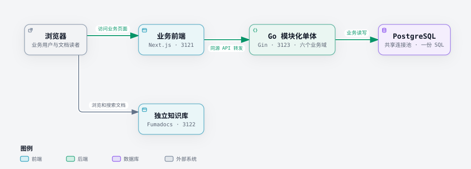
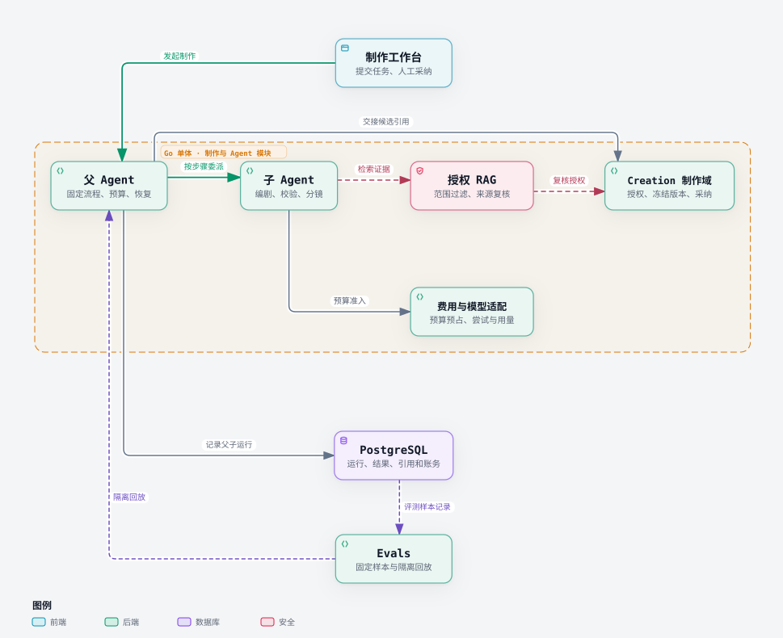

| 项目 | 内容 |
| --- | --- |
| 文档 ID | `DES-ai2workspace-project-overview`。技术选型沿用 `DES-ai2workspace-tech-redesign` 的决定编号 |
| 项目 | 学屿 · Learnis（`ai2workspace`） |
| 更新日期 | 2026-11-26 |
| 定义状态 | 工程现状已核对。原创 IP 首版与 Agent 专题按各自设计评审 |
| 工程基线 | `main` · `349260d` · [应用装配](https://github.com/StephenQiu30/ai2workspace/blob/349260dea4f1f4784147cd96cb46aa91af5bd7f6/backend/internal/app/modules.go) · [Compose](https://github.com/StephenQiu30/ai2workspace/blob/349260dea4f1f4784147cd96cb46aa91af5bd7f6/docker-compose.yml) |
| 产品依据 | [现行原创 IP 专题](./content/00-文档导航.md#学屿原创-ip-制作与共创-saas) · [系统设计与联合验收](./content/design/018-原创IP首版系统设计与验收总览.md) · [Agent 需求](./content/requirement/013-制作Agent与任务编排需求记录.md) |

## 1. 项目范围

学屿以自有原创 IP 为首版业务主线。制作团队维护设定、素材和作品版本，完成剧本、分镜、审片与发布。观众从已发布作品进入观看、制作学习、讨论与二创。商业试点验证自有作品购买、开权、交付和售后。现有账号、课程、媒体、社区、交易及通用问答是可复用的工程基础。

首版用一个自有 IP、一集动态漫及对应商品验证跨域交接。制作场景使用授权 RAG、父子 Agent 和 Evals，候选由制作人员采纳，作品正式版本由制作域维护。详细范围和样本建议见[联合验收](./content/design/018-原创IP首版系统设计与验收总览.md#5-联合验收与交接)。

## 2. 当前工程架构

[总架构图](/design/project/project-architecture.svg) · [图源](/design/project/project-architecture.json) · [制图工具许可](/design/agent/archify-license.txt)

| 工程 | 当前职责 | 本地入口 |
| --- | --- | --- |
| `frontend/` | Next.js 业务应用，承载账号、课程、社区、交易与 Agent 管理。业务 API 使用同源转发 | `3121` |
| `backend/` | 一个 Go module、一个 Gin HTTP 入口。进程入口管理生命周期，`internal/app` 装配六个业务域 | `3123`，就绪检查为 `/api/health` |
| PostgreSQL | 所有业务域使用同一个数据库与连接池。空库由 `backend/schema.sql` 初始化 | Compose 内部连接 |
| `workspace/` | Fumadocs 从知识正文生成页面与搜索，静态构建独立部署 | `3122/docs/` |

- 模块间通过进程内的 Go 接口协作。域内按 `adapter → application → domain` 组织。运行、索引及媒体处理由持有业务状态的模块负责。[目录与依赖规范](./content/01-项目文档与设计规范.md#单体模块的目录与依赖)
- API 契约由 Go DTO 和 Swaggo 注解生成一份 Swagger，再由 Umi 生成统一前端客户端。[前端生成配置](https://github.com/StephenQiu30/ai2workspace/blob/349260dea4f1f4784147cd96cb46aa91af5bd7f6/frontend/openapi2ts.config.ts)
- 本地 Compose 管理工程启动顺序。生产部署与恢复目标随试点环境评审，验证条件见[技术选型](#7-选型与验证)。

## 3. 业务域与事实归属

| 业务域 | 当前代码基础 | 原创 IP 首版交接 |
| --- | --- | --- |
| `identity` | 账号、会话、角色与访问控制 | 为各域提供可信身份，工作区及作品操作由资源所属域复核。[账号与访问控制](./content/design/002-账号与访问控制设计.md) |
| `creation` | 工作区及成员角色查询 | 持有 IP、素材授权、作品版本、候选采纳和发布快照。剧本、分镜、渲染与正式发布处于专题设计阶段。[设定与素材](./content/design/011-原创IP设定与素材设计.md) · [成片制作](./content/design/012-剧本分镜与成片制作设计.md) |
| `agent` | 通用问答、知识入库与检索、供应商适配、用量治理 | 持有制作父子运行、结果及引用。制作域采纳后形成草稿。授权 RAG、Evals 与多 Agent 编排属于首版方案。[Agent 模块详细设计](./content/design/020-Agent模块组织与执行设计.md) · [制作 RAG](./content/design/013-制作知识库与RAG设计.md) |
| `learning` | 课程、媒体与学习进度 | 复用学习行为和媒体访问经验。原创作品及公开制作拆解由制作发布专题定义。[课程与媒体](./content/design/003-课程与媒体学习设计.md) · [发布与制作学习](./content/design/015-作品发布与制作学习设计.md) |
| `community` | 讨论、评论、互动、通知和内容治理 | 讨论绑定作品。二创版本、投稿及原作素材引用由制作域维护。[二创与讨论](./content/design/016-作品二创与讨论设计.md) |
| `commerce` | 课程场景的订单、支付、权益和退款机制 | 订单、渠道结果和权益归交易域，交付引用指定作品版本。真实付款、交付与售后按试点逐项核验。[作品付费与交付](./content/design/017-自有作品付费与交付设计.md) |

PostgreSQL 保存业务状态和各域权威记录。索引、生成候选与媒体文件通过来源、版本或对象引用与业务记录关联，读取时由所属域按当前授权和可用状态判断。

## 4. 数据与任务执行

`backend/schema.sql` 定义空库的全部表、约束和索引。各业务域使用共享 PostgreSQL 连接池，并维护各自的业务记录。开发阶段直接更新这一份 SQL，在隔离空库验证初始化、约束和启动。

Agent 运行与知识索引归 `agent`，分别由 `agent/application/agent` 和 `agent/application/knowledge` 执行。编辑协同和成片处理归 `creation`。异步任务由所属模块负责认领、恢复、重试、并发控制和资源释放，通过应用生命周期统一启动和停止。有明确持久编排需求时评估 Temporal，所需 Workflow 与 Activity 由任务所属模块定义和注册。

## 5. 首版跨域交接

| 链路 | 关键交接 | 产品验收 |
| --- | --- | --- |
| 制作与发布 | 确切的设定与素材版本 → 剧本和分镜 → 冻结审片版本 → 合成 → 发布快照 | [成片制作 PRD](./content/prd/010-剧本分镜与成片制作产品需求.md) AC-01～AC-04 · [发布 PRD](./content/prd/013-作品发布与制作学习产品需求.md) AC-01～AC-03 |
| Agent 候选与证据 | 父 Agent 调度编剧和校验 → 授权检索与候选 → 人工采纳 → 分镜读取确定版本。Evals 回放固定样本 | [制作 RAG PRD](./content/prd/011-制作知识库与RAG产品需求.md) AC-01～AC-03 · [制作 Agent PRD](./content/prd/012-制作Agent与任务编排产品需求.md) AC-01～AC-03 |
| 参与与共创 | 从正式作品进入讨论或二创，提交时固定原作及素材引用，审核时复核权限 | [二创与讨论 PRD](./content/prd/014-作品二创与讨论产品需求.md) AC-01～AC-03 |
| 自营交易与交付 | 可交付版本 → 订单快照 → 核验支付 → 生效权益 → 验证实际访问和售后 | [作品付费与交付 PRD](./content/prd/015-自有作品付费与交付产品需求.md) AC-01～AC-05 |

### 制作 Agent 与成片

Go 校验工作区权限和输入版本，使用幂等键登记任务。付费步骤先预占预算。Agent 保存生成结果，制作域登记候选引用，制作人员确认后生成草稿版本。媒体合成读取冻结的审片版本，将产物交回制作域登记。输入已换版的结果标为过期，已发生的费用按实际用量结算。具体步骤见[制作 Agent](./content/design/014-制作Agent与任务编排设计.md)和[剧本分镜与成片制作](./content/design/012-剧本分镜与成片制作设计.md)。

### 制作 RAG 与权限

索引任务由 `agent/application/knowledge` 按来源和版本执行。制作检索选型为 Milvus 混合召回，接入后通过 PostgreSQL 复核工作区、用途和撤回状态。撤回先更新权威记录，再同步检索索引。详见[制作知识库与 RAG](./content/design/013-制作知识库与RAG设计.md)。

### 协同与媒体

Yjs 和 Tiptap 用于编辑协同，协同草稿与 PostgreSQL 正式快照分别管理，审片与发布引用固定版本。制作域负责 Remotion 成片渲染及资源控制。腾讯云 COS 保存素材与成片，Go 在签发短时访问地址时校验当前用途、作品状态和有效权益。详见[成片制作](./content/design/012-剧本分镜与成片制作设计.md)与[作品发布](./content/design/015-作品发布与制作学习设计.md)。

## 6. Agent、RAG 与 Evals

制作 Agent 的首版设计在同一 Go 后端运行。父 Agent 在指定工作区与作品版本内调度编剧、校验和分镜子 Agent，管理执行上限、确认点和取消。子 Agent 为各自步骤调用授权 RAG，返回结构化候选和可追踪的来源版本。制作人员确认采纳后，由制作域登记草稿版本。

[全屏查看架构图](/design/agent/architecture.html) · [架构图源文件](/design/agent/architecture.json)

Evals 在隔离环境用固定样本回放同一编排链路，核对父子调度、人工确认点、引用与权限、候选交接及用量，供配置或检索变更前后对比。子 Agent 运行契约、恢复场景及详细评分范围见[Agent 模块设计](./content/design/020-Agent模块组织与执行设计.md)。[执行流程图与步骤](./content/design/020-Agent模块组织与执行设计.md#3-父子-agentrag-与任务恢复)

## 7. 选型与验证

当前应用启动以 PostgreSQL 为基线。制作检索、对象存储、媒体渲染、实时协同和持久编排按首版功能的实际需求接入，由对应专题记录实施与验收。

| 决定 | 选择 | 验证边界 |
| --- | --- | --- |
| D-01 / D-02 应用结构 | Next.js + Go 模块化单体，模块间直接调用 | 单一进程、数据库与 Swagger 验收 |
| D-03 / D-04 任务 | Agent、索引和渲染归对应模块。具体任务需要长时间恢复时评估 Temporal | 验证重复提交、失败续跑、人工确认和迟到结果 |
| D-05 数据 | PostgreSQL + `pgx`，一份 `backend/schema.sql` 初始化空库 | 从空库启动，验证授权、支付和索引引用 |
| D-06 / D-07 检索与存储 | 制作 RAG 采用 Milvus，媒体采用腾讯云 COS | 验证权限复核、撤回、直传与短时访问 |
| D-08 / D-09 实时与协同 | SSE 传递进度，Redis 与 Yjs 按实际同步需求接入 | 验证断线重连、并发编辑和版本冻结 |
| D-10 契约 | Gin + Swaggo → Umi OpenAPI → Axios | 核对路由覆盖、客户端生成与实际调用 |
| D-11 模型 | 模型接入、供应商路由和用量治理归 `agent` | 先模拟验证，再核对真实用量、预算与故障恢复 |
| D-12 部署 | Compose 为本地开发入口，生产 Kubernetes 与可观测配置按部署需求验收 | 验证健康检查、运行资源和链路证据 |

## 8. 设计入口与验证

| 阅读目的 | 入口 |
| --- | --- |
| 了解首版功能和跨域验收 | [原创 IP 系统设计与验收总览](./content/design/018-原创IP首版系统设计与验收总览.md) |
| 查看父子 Agent、RAG、Evals 和执行流程图 | [Agent 模块组织与执行设计](./content/design/020-Agent模块组织与执行设计.md) |
| 查询现有页面与视觉基线 | [页面与交互设计](./content/design/009-学屿首版页面与交互设计.md) · [品牌与界面设计规范](./content/design/010-学屿品牌与界面设计规范.md) |
| 追踪需求、PRD、实施计划及验收 | [现行原创 IP 专题索引](./content/00-文档导航.md#学屿原创-ip-制作与共创-saas) |

工程基线通过空库初始化、应用依赖边界、工作区授权及路由与 Swagger 覆盖测试核对。上线、真实付费服务及原创 IP 整条交付链路以专题验收记录为准。
