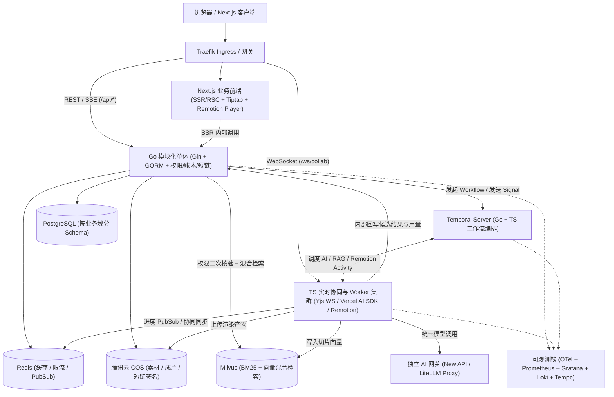

| 项目 | 内容 |
| --- | --- |
| 文档 ID | `DES-ai2workspace-tech-redesign` |
| 所属项目 / 专题 | 学屿 · Learnis（`ai2workspace`）／原创 IP 制作与共创 SaaS |
| 定义状态 | 技术选型已确认（待拆解实施计划与工程改造；当前仓库仍为既有 5 Go 微服务实现） |
| 更新日期 | 2026-11-26 |
| 主要依据及版本 | [原创IP首版系统设计与验收总览](./018-原创IP首版系统设计与验收总览.md) · [设定与素材](./011-原创IP设定与素材设计.md) · [成片制作](./012-剧本分镜与成片制作设计.md) · [制作RAG](./013-制作知识库与RAG设计.md) · [制作Agent](./014-制作Agent与任务编排设计.md) · [作品发布](./015-作品发布与制作学习设计.md) · [二创讨论](./016-作品二创与讨论设计.md) · [付费交付](./017-自有作品付费与交付设计.md) |
| 关联工程 | 仓库根目录 [PROJECT.md](../../../PROJECT.md)、`frontend/`、`backend/`、规划新增 `worker/`、`workspace/` |
| 适用规范与例外 | 引用[项目文档与设计规范](../standards/001-项目文档与设计规范.md#工程规范与目录设计)；新增例外界定见第 2 节（GORM 模型标签、Node/TS Worker 与 Remotion 组件、Yjs 协同协议） |

## 1. 背景、目标与约束

### 1.1 现状观察（截至 2026-11-26）

- **既有实现**：仓库当前包含 `frontend/`（Next.js 16 + React 19 + TS strict + Tailwind v4 + shadcn/ui Radix + Axios + `@umijs/openapi` + Tiptap）、`backend/services/` 下 5 个独立 Go 微服务（`identity`、`learning`、`commerce`、`community`、`assistant`，采用 Gin + `pgx/v5` + Swaggo 2.0 + Traefik + Docker Compose）及独立知识库 `workspace/`（Fumadocs）。
- **业务演进带来的技术缺口**：产品方向已升级为「学屿原创 IP 制作与共创 SaaS」，新增了 **IP 资产与授权、剧本/分镜多人协作、平台级动态漫 MP4 合成、权限强隔离的制作 RAG、带人工确认点与预算治理的制作 Agent 编排** 等高复杂链路。
- **既有 5 服务架构在当前阶段的张力**：
  1. 跨服务一致性与维护成本偏高（5 套 `go.mod`、5 份 Swagger、5 个网关路由与跨服务 HTTP 编排），若再新增第 6 个制作微服务，将显著拉高首版交付与联调复杂度。
  2. 缺少长任务持久编排、向量混合检索、程序化视频合成、实时流式推送、多人协同编辑及统一多模态模型治理的技术选型。

### 1.2 重设计目标与边界

- **保留基线**：保留 **Next.js + React + TypeScript + Tailwind + shadcn/ui (Radix)** 前端基线、**Go + Gin + Swaggo + `@umijs/openapi` + Axios** 的 API 契约自动生成铁律，以及 `workspace/` 独立知识库。
- **核心重构**：将 Go 后端收拢为**模块化单体**以消除不必要的分布式事务与运维摩擦；引入 **Node/TS 独立异步 Worker** 承接 Remotion 动态漫合成、Vercel AI SDK 编排与 Yjs 多人协同；通过 **Temporal、Milvus、腾讯云 COS、Redis、独立 AI 网关及 Kubernetes + 可观测栈** 完整补齐生产级基础设施选型。
- **非目标**：本轮仅完成技术选型与架构重设计，不直接启动代码改造、数据库迁移、容器改写或 Git 提交；实际实施须待后续执行计划批准后分阶段推进。

## 2. 目标架构与技术选型总览

### 2.1 整体技术栈矩阵

| 领域 | 目标选型 | 变更类型 | 职责与边界说明 |
| --- | --- | --- | --- |
| 业务前端 | Next.js App Router + React 19 + TS strict + Tailwind v4 + shadcn/ui (Radix) + Tiptap | 沿用 | RSC 优先，承担公开展示、IP 制作工作台、分镜预览（复用 Remotion Player）、审片、二创与交易界面 |
| API 契约链路 | Gin + Swaggo 2.0 → `@umijs/openapi` → Axios | 沿用并收拢 | Go 收拢为单一模块化单体后仅维护**一份**统一 Swagger 产物，严禁手写 Swagger 或前端接口副本 |
| 核心业务后端 | **Go 模块化单体**（按业务域拆包 + 独立 PostgreSQL Schema） | **重构** | 统一承载账号、制作/IP、发布、二创、社区、交易、预算账本、权限与短链签发，作为业务与数据权威 |
| 异步与 AI/媒体 Worker | **Node.js / TypeScript 独立 Worker**（Remotion + Vercel AI SDK） | **新增** | 执行编剧/分镜/校验 Agent、RAG 切片向量化、多模态生成调用与 Remotion 动态漫 MP4 渲染 |
| 跨语言工作流编排 | **Temporal**（原生 Go SDK + TypeScript SDK） | **新增** | 编排长任务、步骤幂等、断点续跑、超时重试、取消与人工确认点（Signals） |
| 关系型数据库与 ORM | PostgreSQL + **GORM**（`pgx` 驱动）+ 版本化 SQL 迁移（`goose`） | **调整** | 按业务域分 Schema 隔离；生产严禁 `AutoMigrate`，所有表结构变更走版本化 SQL 迁移 |
| 向量与混合检索（RAG） | **Milvus**（本地 Standalone / 生产 K8s 集群或 Zilliz Cloud） | **新增** | 原生 BM25 稀疏向量 + 稠密语义向量 + RRF 混合检索；按 `workspace_id`/`ip_id` 分区隔离，**召回后强制回查 PG 权限与撤回状态** |
| 对象存储与受控媒体 | **腾讯云 COS** + 服务端鉴权 + 短链/短时签名验证 | **新增** | 承接素材直传、成片 MP4 存储与受控播放；所有上传/预览/播放链接均经 Go 服务端实时鉴权并签发短时效凭证 |
| 缓存与实时推送 | **Redis** + **SSE**（Server-Sent Events） | **新增** | Redis 负责会话、限流、预算并发锁、短链缓存、进度 Pub/Sub 与协同状态同步；SSE 负责 Agent 流式文本与渲染进度单向推送 |
| 多人实时协同 | **CRDT（Yjs）+ WebSocket**（对接 Tiptap） | **新增** | 支撑剧本、设定、分镜的多人实时协同编辑；协同编辑态与 PG 正式版本/审片冻结快照严格分离 |
| 模型接入层 | **独立 AI 网关**（New API / LiteLLM Proxy） | **新增** | 统一托管多厂商 LLM、Embedding 及多模态（图/音/视频）Key、路由、限流与熔断；Go 单体持有预算准入与计费账本权威 |
| 网关与部署编排 | 本地 Docker Compose；生产 **Kubernetes（K8s）** + Traefik Ingress | **升级** | 生产应用与中间件统一入 K8s 编排，Remotion 渲染 Worker 按 CPU/内存独立 HPA 扩缩容 |
| 可观测性 | OpenTelemetry（Go + Node）+ **Prometheus + Grafana + Loki + Tempo** | **明确** | 覆盖指标、日志、分布式 Trace（贯穿 Frontend → Go → Temporal → TS Worker → AI Gateway） |

### 2.2 系统拓扑图



### 2.3 目录与模块职责规划（目标态）

以下为重构后的目标工程结构，**当前仓库仍保留既有 5 服务代码直至实施计划启动**：

```text
ai2workspace/
├── frontend/                  Next.js 前端（复用共享 Remotion 渲染组件与 Yjs/Tiptap 协同）
├── backend/                   Go 模块化单体（单一 go.mod，按业务域拆包 + 独立 DB Schema）
│   ├── cmd/server/main.go     统一 HTTP/SSE 入口、Temporal Client 与优雅停机
│   ├── api/                   统一自动生成的 Swagger 契约（swagger.json / docs.go）
│   ├── migrations/            goose 版本化 SQL 迁移（按 schema 组织）
│   ├── internal/
│   │   ├── platform/          配置、GORM/PG、Redis、COS 短链签发、Milvus、Temporal、OTel
│   │   ├── identity/          账号、认证、工作区与访问控制（schema: identity）
│   │   ├── studio/            原创 IP 设定、素材授权、剧本/分镜/成片、发布、二创（schema: studio）
│   │   ├── assistant/         制作知识库编排、Agent 运行记录、预算准入与费用账本（schema: assistant）
│   │   ├── commerce/          自有作品商品、订单、支付、权益与退款对账（schema: commerce）
│   │   ├── community/         作品讨论、回复与内容治理（schema: community）
│   │   └── learning/          兼容既有课程与媒体学习模块（schema: learning）
│   └── tests/                 独立单元与集成测试目录（遵循既有规范）
├── worker/                    [规划新增] Node.js / TypeScript 异步 Worker 与协同服务
│   ├── src/
│   │   ├── temporal/          Temporal TypeScript Worker 与 Activity 注册
│   │   ├── agents/            Vercel AI SDK 编剧 / 分镜 / 一致性校验 Agent
│   │   ├── rag/               文档切片、Embedding 与 Milvus 写入
│   │   ├── remotion/          动态漫合成组件与 MP4 渲染执行器（与前端预览同源）
│   │   └── collab/            Yjs CRDT WebSocket 协同服务与快照同步
│   └── tests/                 Worker 独立测试目录
├── deploy/                    [规划新增] K8s Manifests / Helm Charts 与可观测配置
├── tests/                     跨模块契约与端到端测试
└── workspace/                 Fumadocs 知识库（保持独立静态构建）
```

> [!NOTE]
> **规范例外边界**：
> 1. `backend/internal/<业务域>/` 允许引入 GORM 结构体标签与域内迁移脚本，仍坚持扁平包结构、禁用 Java 式多层嵌套，且生产环境严禁调用 `AutoMigrate`。
> 2. `worker/` 作为独立 TypeScript 运行时模块，遵循 Google TypeScript strict 规范，允许保留 Remotion 组件入口与 Temporal Activity 约定的导出形态。
> 3. REST 契约继续严格遵守 Swaggo + `@umijs/openapi` 自动生成铁律；SSE 与 Yjs WebSocket 协议单独在接口设计中定义消息结构，不强行塞入 Swagger 2.0。

## 3. 核心交互与关键链路设计

### 3.1 制作 Agent 与动态漫合成（Temporal + TS Worker）

1. **发起与准入**：用户在工作台触发「生成剧本草稿 / 转为分镜 / 一致性校验 / 合成 MP4」→ 请求到达 Go 单体 → Go 校验工作区权限、核对输入版本，并在事务内完成**预算预占**与任务记录创建（幂等 Key 防重）。
2. **持久编排**：Go 通过 Temporal Client 启动对应 Workflow（Workflow ID 绑定业务幂等键）。
3. **步骤执行与实时反馈**：
   - Temporal 调度 TS Worker 执行 Activity（AI SDK 经独立 AI 网关调用 LLM/多模态模型，或 Remotion 拉取 COS 授权素材渲染 MP4）。
   - 执行过程中，TS Worker 将流式文本片断和渲染百分比发布至 Redis Pub/Sub，Go 单体通过 **SSE** 实时推送给前端任务抽屉。
4. **人工确认与防覆盖**：
   - Agent 产出只写入候选区，不直接覆盖正式版本；Workflow 在人工确认节点等待 Signal（或独立结束，由用户在界面显式采纳）。
   - 渲染完成的 MP4 上传至腾讯云 COS，TS Worker 回传媒体 Key、耗时与实际用量给 Go 单体；Go 核验输入版本是否过期（过期则标记为待核对而非覆盖最新稿），结算实际费用并释放剩余预占额度。

### 3.2 制作 RAG 检索与撤回强隔离（Milvus + PG 二次核验）

1. **索引同步**：设定审批定稿、剧本定版或素材开放范围变更后，Go 触发 Temporal 索引 Workflow → TS Worker 切片并经 AI 网关生成稠密向量 → 写入 Milvus（附带 `workspace_id`、`ip_id`、`source_id`、`source_version_id`、`visibility_scope` 字段，开启 BM25 稀疏检索）。
2. **检索与强权限过滤**：检索请求经 Go 校验当前会话与用途（内部制作 / 公开 / 二创）→ 携带强制过滤条件查询 Milvus（BM25 + 稠密向量 RRF 混合检索）→ 拿到候选列表后，**Go 必须回查 PostgreSQL 权威表核验 `source_id` 当前有效且未撤回**，过滤掉同步窗口期内的失效切片后再返回前端或送入 Agent。
3. **撤回处理**：素材或设定撤回时，Go 先在 PG 事务内立即更新权威状态（即时阻断所有新检索与新访问），同时向 Temporal 派发高优先级清理任务删除/标记 Milvus 切片，并配合定期对账任务防漂移。

### 3.3 多人实时协同编辑与版本冻结（Yjs CRDT + PG 快照）

1. **鉴权接入**：前端 Tiptap 编辑器向 Go 单体申请协同会话 Token（绑定用户、工作区、文档 ID 与编辑权限）→ 建立至协同服务的 WebSocket 连接。
2. **实时同步**：多客户端通过 **Yjs CRDT** 自动解决并发冲突，多副本协同节点经 Redis Pub/Sub 同步增量更新，并周期性持久化 Yjs 二进制更新日志以防节点重启丢失草稿。
3. **版本固化**：当创作者点击「保存新版本」或「提交审片」时，将当前协作态物化为结构化内容写入 PostgreSQL 正式版本表（带乐观锁与版本 ID），供分镜引用、RAG 索引和审片冻结使用。

### 3.4 腾讯云 COS 受控上传与短链验证

- **上传**：前端向 Go 请求上传许可 → Go 校验角色、文件类型与大小限制 → 签发腾讯云 COS 短时效预签名上传凭证（限定 Key 前缀与最大体积）→ 前端直传 COS → 回调 Go 登记素材元数据与授权记录。
- **读取与受控播放**：前端不直接持有永久 COS URL；预览、下载、试看与付费正片均通过 Go 签发**短链 / 短时效签名访问地址**。每次请求签发或短链跳转时，Go 实时核验：作品发布状态、素材是否被撤回、以及用户是否持有有效购买权益（`commerce` 模块）。撤回或退款后，短链立即失效且拒绝签发新签名。

## 4. 数据边界与一致性约定

| 边界 | 权威来源 | 一致性策略与失败恢复 |
| --- | --- | --- |
| 跨模块业务数据 | PostgreSQL 独立 Schema（`identity`/`studio`/`assistant`/`commerce`/`community`/`learning`） | 域内强一致事务；模块间通过显式 Go 接口调用，严禁跨 Schema 直接 JOIN 绕过领域规则 |
| 异步长任务与费用 | Go `assistant` 账本 + Temporal Workflow 状态 | 先预占预算再启 Workflow；Activity 失败自动按策略重试；费用未知状态进入人工核对队列，禁止用盲目重试替代账务确认 |
| RAG 向量与撤回 | PostgreSQL（权限权威）+ Milvus（检索索引） | 写路径最终一致（Temporal 异步同步）；读路径强一致（PG 二次权威核验） |
| 协同草稿与正式版 | Yjs/Redis（编辑态）+ PostgreSQL（正式快照） | 编辑态高可用同步，审片/发布/引用只认 PG 固化版本 ID |
| 媒体文件与访问权 | 腾讯云 COS（文件存储）+ PostgreSQL（权限/权益） | 短时效预签名 + 服务端短链重查授权；撤回后立即阻断访问并通知受影响发布与订单 |

## 5. 取舍与设计决定

| 决定 ID | 决策问题与备选方案 | 已确认选择及依据 | 风险与缓解措施 |
| --- | --- | --- | --- |
| D-01 | 重设计范围：全面推倒 vs 仅补新模块 vs 在 Next.js+Go 基础上重构架构边界并补齐新能力 | **在现有 Next.js + Go 基础上重构架构边界并补齐 AI/媒体/协同能力**；复用既有投资并解决首版最大短板 | 需做好既有 5 服务代码向模块化单体的平滑迁移 |
| D-02 | 后端架构形态：延续 5+1 微服务 vs 3 粗粒度服务 vs Go 模块化单体 + 独立 Worker | **Go 模块化单体（分 Schema）+ 独立异步 Worker**；消除首版跨服务分布式复杂度，同时保留按域拆分演进路径 | 须通过代码规范与 CI 检查禁止跨 Schema 越权查询，防止退化为大泥球 |
| D-03 | 异步 Worker 语言：纯 Go vs Python vs Node/TS | **Node/TS Worker（Remotion + Vercel AI SDK）**；与前端共享 TS/React 栈，实现动态漫前端预览与后端成片渲染同源 | Node 侧重 CPU 渲染需独立池化隔离，避免阻塞 AI/协同事件循环 |
| D-04 | 跨语言异步编排：PG 轮询 vs 轻量队列 vs Temporal | **Temporal**；原生双语言 SDK（Go + TS），开箱即用解决长任务续跑、幂等、取消与人工确认点 | 增加 Temporal Server 运维，纳入 K8s 统一管理并配置持久化存储 |
| D-05 | 持久层工具：纯 `pgx` vs `sqlc` vs ORM（GORM/Ent） | **GORM（`pgx` 驱动）+ 版本化 SQL 迁移（`goose`）**；贴合扁平包结构、开发效率高 | 生产严格禁用 `AutoMigrate`，复杂统计/锁查询保留原生 SQL 能力 |
| D-06 | RAG 检索引擎：仅全文 vs PG+`pgvector` vs Milvus | **首版直接采用 Milvus**；原生 BM25 + 稠密向量混合检索与多租户分区，更贴合原创 IP 角色别名与语义检索 | 强制执行「Milvus 召回 + PG 二次权威核验」及撤回对账，杜绝越权 |
| D-07 | 对象存储与受控分发：自建 MinIO/HLS vs 腾讯云 COS 短链验证 | **腾讯云 COS + 服务端鉴权与短链/短时签名验证**；减少自建存储与转码负担，精准控制受控访问与撤回 | 需在本地与测试环境配置隔离测试桶，严禁凭据入库 |
| D-08 | 缓存与实时流：无 Redis 轮询 vs Redis+SSE vs WebSocket | **Redis + SSE**；满足会话、限流、预算锁、进度 Pub/Sub 与 Agent 流式输出 | SSE 需在 Traefik Ingress 显式关闭响应缓冲并配置长连接超时 |
| D-09 | 多人实时协作：无协同/悲观锁 vs CRDT（Yjs） | **引入 CRDT（Yjs）+ WebSocket**，结合前端 Tiptap 实现剧本/设定/分镜多人实时编辑 | 严格隔离协同草稿与正式固化版本，避免未审阅内容泄露至发布或 RAG |
| D-10 | API 契约链路：沿用 Swaggo+Umi OpenAPI vs 升级 OpenAPI 3.1 | **沿用 Gin + Swaggo + `@umijs/openapi` + Axios**；单体化后仅维护一份 Swagger，改动最小 | Swagger 2.0 限制复杂联合类型，DTO 保持清晰扁平结构 |
| D-11 | 模型接入层：直连各厂商 vs 单一云厂商 vs 独立 AI 网关 | **独立 AI 网关（New API / LiteLLM Proxy）**；统一多厂商 Key 托管、限流与熔断 | AI 网关为关键依赖，K8s 需配置多副本、健康检查与超额兜底 |
| D-12 | 生产部署与可观测：单机 Compose vs 托管混合 vs 全量 K8s | **生产全量 Kubernetes（K8s）+ Prometheus + Grafana + Loki + Tempo + OTel**；统一管理多组件与独立渲染伸缩 | K8s 集群及有状态组件（PG/Milvus/Temporal/Redis）初期运维门槛较高，须在实施计划中明确 Helm 基线与备份恢复演练 |

## 6. 迁移演进与实施顺序建议

本设计批准后，建议在后续执行计划（`workspace/content/plan/`）中按以下阶段推进，避免一次性大爆炸重构：

1. **阶段一：基础设施与 K8s/Compose 基线** — 固化本地 Docker Compose（PG、Redis、Milvus Standalone、Temporal Dev、AI Gateway）与 K8s Helm 基线、腾讯云 COS 测试桶接入及 OTel 可观测接入。
2. **阶段二：Go 模块化单体收拢** — 建立统一 `backend/` 单体骨架（GORM + `goose` + 统一 Swagger），依次迁入既有 `identity`、`commerce`、`community`、`learning`、`assistant` 核心能力并保持前端已有页面回归通过。
3. **阶段三：Node/TS Worker 与 Temporal 贯通** — 搭建 `worker/`（Temporal TS Worker + Vercel AI SDK + AI 网关对接 + Milvus 混合检索与 PG 二次核验），跑通编剧/分镜/校验 Agent 与 SSE 进度流。
4. **阶段四：原创 IP 制作、协同与 Remotion 成片** — 落地 `studio` 模块、Yjs/Tiptap 多人协同、COS 短链受控分发与 Remotion 30–60 秒动态漫 MP4 合成，完成 `018` 规定的联合验收。

## 7. 验证与验收映射

| 专题 / 需求依据 | 对应设计决定 | 技术验证方法 | 结果记录位置 |
| --- | --- | --- | --- |
| 原创 IP 设定与素材（[011](./011-原创IP设定与素材设计.md) NFR-01～03） | D-05、D-07、D-09 | 验证 COS 预签名直传、短链鉴权与撤回后立即失效；验证 Yjs 协同固化版本冲突处理 | 待后续执行计划绑定 |
| 剧本分镜与成片制作（[012](./012-剧本分镜与成片制作设计.md) AC-01～04, NFR-01～03） | D-03、D-04、D-08、D-09 | 验证 Temporal 调度 Remotion 合成 30–60s 动态漫 MP4、SSE 进度推送、失败续跑与过期结果不覆盖 | 待后续执行计划绑定 |
| 制作知识库与 RAG（[013](./013-制作知识库与RAG设计.md) AC-01～03, NFR-01～03） | D-04、D-06 | 验证 Milvus BM25+向量混合检索命中率、多租户分区隔离及撤回后 PG 二次核验拦截 | 待后续执行计划绑定 |
| 制作 Agent 与任务编排（[014](./014-制作Agent与任务编排设计.md) AC-01～03, NFR-01～03） | D-03、D-04、D-08、D-11 | 验证预算预占、AI 网关路由与限流、人工确认点 Signal、重复提交幂等及费用账本核对 | 待后续执行计划绑定 |
| 发布、二创与付费交付（[015](./015-作品发布与制作学习设计.md)～[017](./017-自有作品付费与交付设计.md)） | D-02、D-05、D-07、D-10 | 验证单一 Swagger → `@umijs/openapi` 生成链路、公开快照与付费短链权益校验及退款撤权 | 待后续执行计划绑定 |
| 工程质量与生产运维 | D-10、D-12 | 验证 Google Go/TS 检查、独立 `tests/` 测试、K8s 探活/HPA 与 OTel/Grafana/Loki/Tempo 链路追踪 | 待后续执行计划绑定 |

## 8. 待确认与评审记录

| 问题 / 假设 | 影响范围 | 当前状态 |
| --- | --- | --- |
| 独立 AI 网关具体选型（New API vs LiteLLM Proxy）与首批接入模型供应商清单 | `worker/`、费用治理与部署配置 | 待进入阶段一前确定 |
| K8s 生产环境有状态组件（PostgreSQL、Milvus、Temporal、Redis）的自建 Operator 与云托管边界 | `deploy/` 与运维 SLA | 待部署设计细化 |
| Remotion 渲染池单集 30–60s 动态漫的 CPU/内存基准规格与并发上限 | K8s HPA 与成本评估 | 待阶段四样片实测标定 |
| 腾讯云 COS 正式桶、自定义短链域名、防盗链及账单归属 | `backend/internal/platform` 与发布上线 | 待真实环境准入前确认 |
